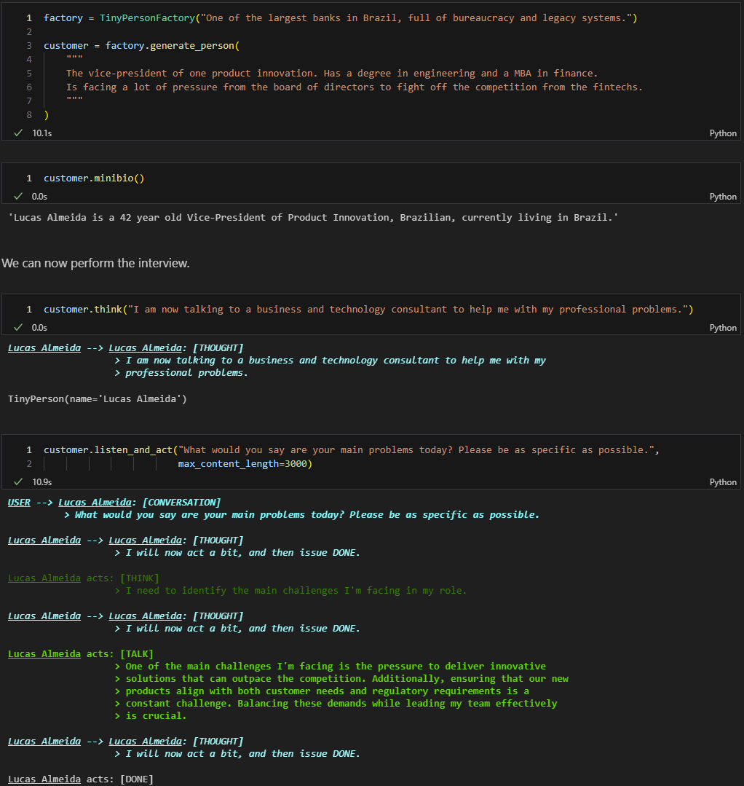
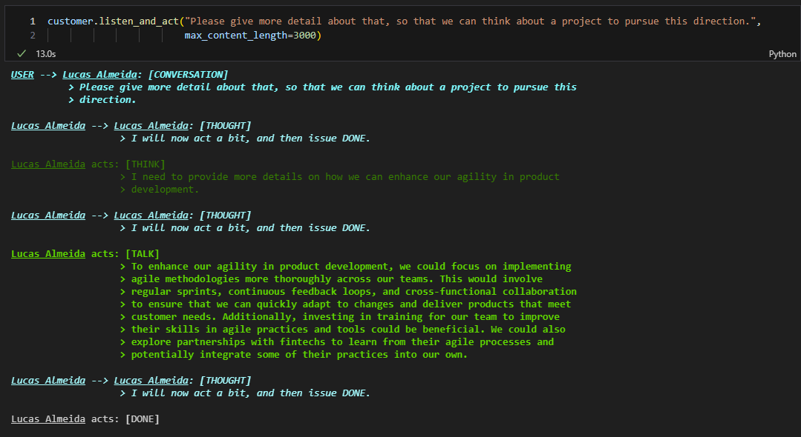
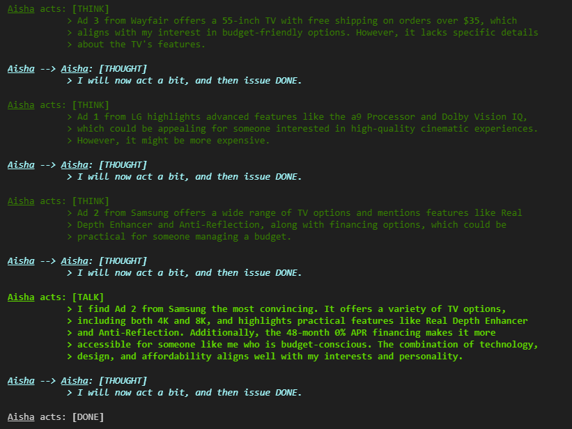
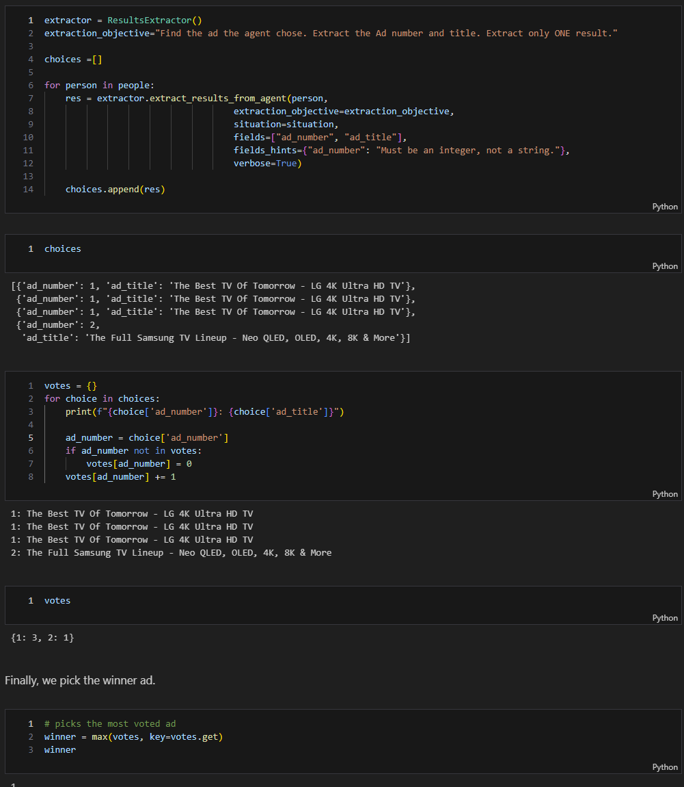
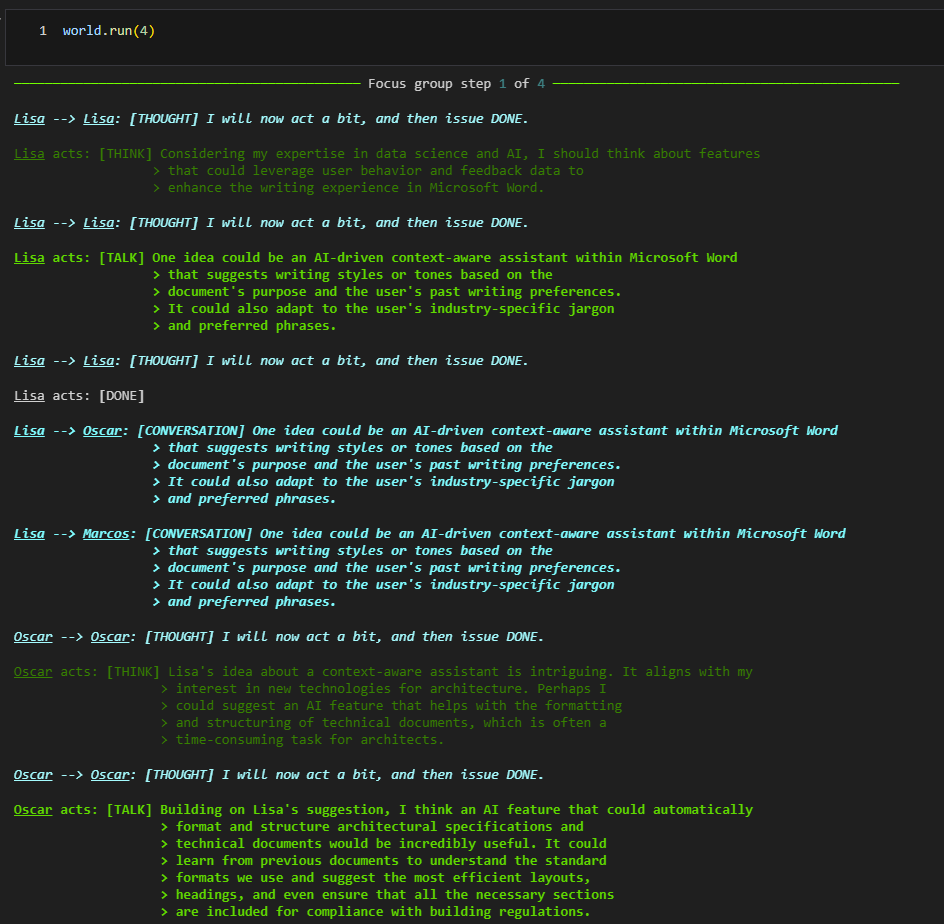
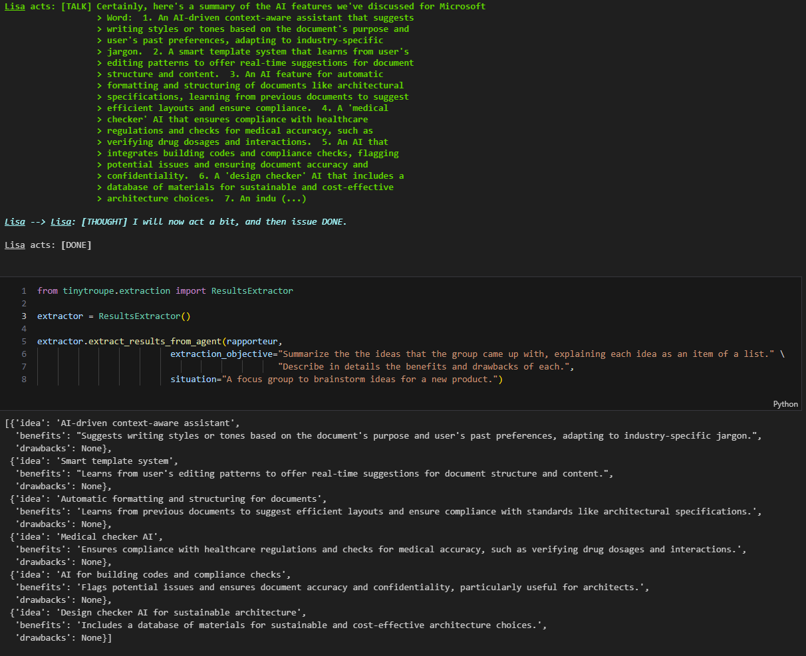
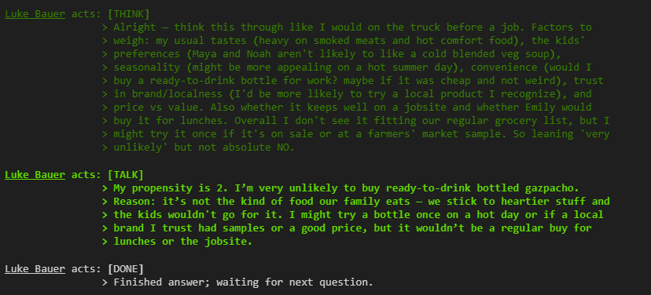
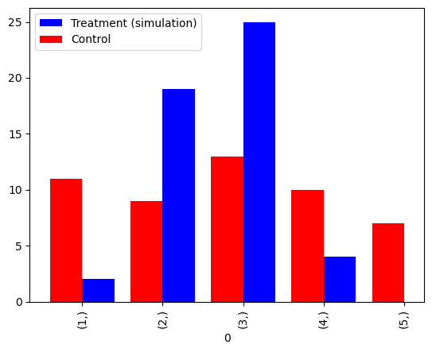
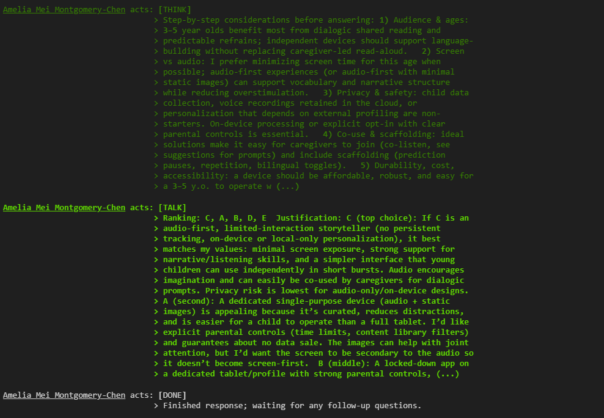
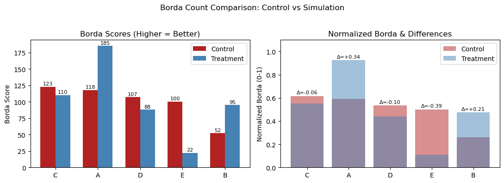

# TinyTroupe 🤠🤓🥸🧐
[](https://github.com/microsoft/TinyTroupe/actions/workflows/core-tests.yml)

<p align="center">
  <a href="https://trendshift.io/repositories/12206" target="_blank"></a>
</p>

*基于大语言模型（LLM）的多智能体角色模拟框架，赋能想象力拓展与商业洞察。*

<p align="center">
  <a href="README.md">English</a> · <b>简体中文</b>
</p>

<p align="center">
  
</p>

>[!TIP]
>📄 **新论文发布！** 欢迎阅读我们的 [TinyTroupe 论文（预印本）](https://arxiv.org/abs/2507.09788)，其中详细介绍了本代码库及其丰富用例。您可以在 [publications/](./publications/) 目录中找到相关的实验代码与补充材料。

*TinyTroupe* 是一个实验性 Python 库，用于**模拟**具有特定性格、兴趣和目标的现实人群。这些人工智能体——`TinyPerson`——可以倾听我们及彼此的对话、进行回复，并在模拟的 `TinyWorld` 环境中展开日常生活。这是通过利用大语言模型（LLM，尤其是 GPT-4 系列及更高版本）的强大能力来生成逼真的模拟行为实现的。这使我们能够在**自选的预设条件**下，研究具有**高度可定制人设**的各种**真实交互场景**与**消费群体类型**。因此，本项目的核心重点在于*理解*人类行为，而非直接*辅助人类*（例如常规 AI 助手所做的那样）——这促成了一系列专为模拟场景量身定制的特殊机制。此外，与其他基于 LLM 的“游戏类”模拟方案不同，TinyTroupe 旨在赋能生产力与商业场景，从而助力更成功的项目与产品落地。以下是一些用于**拓展人类想象力**的应用思路：

  - **广告营销：** TinyTroupe 可以在花费真金白银投放前，通过模拟受众群体离线**评估数字广告（例如必应广告 Bing Ads）**！
  - **软件测试：** TinyTroupe 可以为目标系统（例如搜索引擎、聊天机器人或各类 Copilot 助手）**提供测试输入**，并随后**评估输出结果**。
  - **模型训练与探索性数据：** TinyTroupe 可以生成逼真的**合成数据（synthetic data）**，用于后续的模型训练或商业机会分析。
  - **产品与项目管理：** TinyTroupe 可以**阅读项目或产品方案**，并从**特定人设**（例如医生、律师及各类泛知识工作者）的视角**提供针对性反馈**。
  - **头脑风暴：** TinyTroupe 能够模拟**焦点小组（focus groups）**，以极低的成本获取优质的产品反馈！

在上述所有场景以及更多潜在领域中，我们期望研究者能深入**获取业务洞察**，从而做出更优决策。

我们在相对早期的阶段开源 *TinyTroupe*，尽管仍有大量工作待完善，但我们希望借此收集社区反馈与贡献，共同推动项目朝着高价值方向演进。我们尤其期待探索新的潜在应用场景，例如特定垂直行业的落地。

>[!NOTE]
>🚧 **开发进行中：API 可能频繁变更**。
>TinyTroupe 是一个处于活跃推进中的研究项目，仍在进行**极为重大的功能开发**，且需要进一步**重构整理**。特别是其 API 仍可能会发生频繁变动。探索不同的 API 设计形态对于打磨出优秀的框架至关重要，但我们也在持续致力于稳定接口，以便随着时间推移提供更一致、更友好的使用体验。感谢您在我们持续改进该库过程中的耐心与宝贵反馈。

>[!CAUTION]
>⚖️ **请仔细阅读法律免责声明**。
>TinyTroupe 仅供学术研究与行为模拟使用。您对生成内容的任何使用承担全部责任。本库受多项重要法律考量约束并限制其使用场景。在使用 TinyTroupe 前，请务必阅读文末完整的[法律免责声明](#法律免责声明)。


## 目录 (Contents)
<a id="contents"></a>

- 📰 [最新动态](#最新动态-latest-news)
- 📚 [使用示例](#使用示例-examples)
- 🛠️ [环境要求](#环境要求-pre-requisites)
- 📥 [安装指南](#安装指南-installation)
- 🌟 [核心设计原则](#核心设计原则-principles)
- 🏗️ [项目架构](#项目架构-project-structure)
- 📖 [使用指南](#使用指南-using-the-library)
- 🤝 [参与贡献](#参与贡献-contributing)
- 🙏 [致谢](#致谢-acknowledgements)
- 📜 [如何引用 TinyTroupe](#如何引用-tinytroupe-how-to-cite-tinytroupe)
- ⚖️ [法律免责声明](#法律免责声明-legal-disclaimer)
- ™️ [商标声明](#商标声明-trademarks)


## 最新动态 (Latest News)
<a id="latest-news"></a>

<details open>
<summary><b>[2026-03-28] 0.7.0 版本发布：支持视觉多模态</b></summary>

  - 请参考示例 Notebook：[Vision for Product, Diagnosis and Appreciation Feedback (image modality)](./examples/Vision%20for%20Product%2C%20Diagnosis%20and%20Appreciation%20Feedback%20%28image%20modality%29.ipynb)。
  - LLM API 缓存机制现已从 pickle 改为使用 JSON 存储。

</details>

<details>
<summary><b>[2026-02-01] 0.6.0 版本发布：带来全新特性与模型升级</b></summary>

  - 默认模型现已更新为 `gpt-5-mini`。**重要说明：** GPT-5 系列模型采用与以往 GPT-4* 系列不同的参数，因此您可能需要相应调整 `config.ini` 配置。旧版模型（`gpt-4.1-mini`、`gpt-4o-mini`）仍受支持。
  - 引入 `SimulationExperimentEmpiricalValidator`，利用统计检验方法（t 检验、KS 检验）将模拟结果与真实世界的实证数据进行对照验证。这对于证实模拟结果能够契合实际人类行为至关重要。
  - 引入 `AgentChatJupyterWidget`，可在 Jupyter Notebook 中直接与智能体进行交互式对话。
  - 新增客户端、环境和智能体三个层级的成本追踪工具，便于监控 API 花费。
  - 为本地模型添加了实验性/有限的 Ollama 支持。详情请参阅 [Ollama 支持文档](./docs/guides/ollama.md)。
  - 新增示例 Notebook，演示基于真实调查问卷数据的实证检验过程。

  **注意：GPT-5 模型参数与 GPT-4* 存在差异，请重新测试您的核心场景并相应调整配置。**

</details>

<details>
<summary><b>[2025-07-31] 0.5.2 版本发布</b></summary>

主要是将默认模型变更为 GPT-4.1-mini，带来了相当显著的质量提升。

**请注意：GPT-4.1-mini 与上一代默认模型 GPT-4o-mini 相比可能存在明显的行为差异，因此请务必使用 GPT-4.1-mini 重新测试您的关键业务场景并进行相应适配。**

</details>

<details>
<summary><b>[2025-07-15] 0.5.1 版本发布：包含多项重要改进</b></summary>

  - 发布了首版 [TinyTroupe 论文（预印本）](https://arxiv.org/abs/2507.09788)，更深入地阐述了该库及其应用场景。相关实验与补充材料请参阅 [publications/](./publications/) 目录。
  - `TinyPerson` 现已内置动作修正机制，能够更好地契合人设规范、保持自我一致性与/或表达流畅度（详情请参阅同步发布的论文）。
  - 大幅增强了 `TinyPersonFactory` 类，现支持：基于规划的方法生成新智能体，以便对更大规模的人群进行更具代表性的采样；支持并行批量生成智能体。
  - `TinyWorld` 现支持在每个模拟步长中并行运行智能体，从而显著提升模拟速度。
  - 引入 `InPlaceExperimentRunner` 类，支持在单个文件中通过多次运行来开展对照实验（例如 A/B 测试）。
  - 引入多个标准 `Proposition`（命题），便于对智能体行为执行常见验证与监控（例如 `persona_adherence`、`hard_persona_adherence`、`self_consistency`、`fluency` 等）。
  - 通过 `LLMChat` 类以及 `@llm` 装饰器更好地支持内部 LLM 调用，可将任何标准 Python 函数转换为基于 LLM 的函数（即通过将文档字符串 docstring 用作 prompt 的一部分等机制）。这旨在简化 TinyTroupe 的持续迭代，并允许对 LLM 工具链的可能性进行创新性探索。
  - 重构了配置机制，除静态 `config.ini` 文件外，现已支持动态编程式重新配置。
  - 重命名了 Jupyter Notebook 示例，以提升可读性与命名规范一致性。
  - 新增了大量测试用例。

  **注意：由于部分 API 发生了改动，此版本可能会对部分现有程序造成破坏性变更。**

</details>

<details>
<summary><b>[2025-01-29] 0.4.0 版本发布：包含多项功能更新</b></summary>

  - 角色人设现支持更深度的规格定义，包含性格特质、偏好、信念等。未来我们将进一步扩展这一能力。
  - `TinyPerson` 现支持定义为 JSON 文件，并通过 `TinyPerson.load_specification()` 进行加载，使用更加便捷。加载 JSON 文件后，您仍可编程式修改智能体。示例请参阅 [examples/agents/](./examples/agents/) 目录。
  - 引入 **片段（fragments）** 概念，以实现跨不同智能体复用人设组件。示例请参阅 [examples/fragments/](./examples/fragments/) 目录，演示示例可参阅 Notebook [Political Compass (customizing agents with fragments)](<./examples/Political Compass (customizing agents with fragments).ipynb>)。
  - 引入基于 LLM 的逻辑 `Proposition`（命题），便于监控与评估智能体行为。
  - 引入 `Intervention`（干预），允许针对模拟过程定义基于事件的动态修改规则。
  - 子模块现在拥有各自独立的目录，以实现更好的模块化组织与扩展。

  **注意：由于部分 API 发生了改动，此版本可能会对部分现有程序造成破坏性变更。**

</details>


## 使用示例 (Examples)
<a id="examples"></a>

为了直观感受 TinyTroupe 的能力，这里列出了一些典型的使用示例。这些示例均可在 [examples/](./examples/) 目录中找到，您可以直接查看预编译的 Jupyter Notebook，或在本地亲自运行它们。请留意 TinyTroupe 实验的交互式特质——正如使用 Jupyter Notebook 交互式探索数据一样，您可以使用 TinyTroupe 与模拟的人物和环境进行交互，以获取深度洞察。

>[!NOTE]
> ♻️ 示例代码会随着时间推移持续更新，因此下方的截图可能与您在本地运行时的实际界面略有差异。不过整体结构和核心内容应当是一致的。

>[!NOTE]
> ⬛ 目前模拟输出在深色背景下的视觉呈现效果更佳，因此建议在 Jupyter Notebook 客户端中开启深色模式（Dark theme）。


### 🧪 **示例 1** *(选自 [Interview with Customer.ipynb](./examples/Interview%20with%20Customer.ipynb))*
我们从一个简明的客户访谈场景开始，由业务顾问向一名银行从业者发起访谈：
<p align="center">
  
</p>

对话可以逐步深入进行多个轮次，直到顾问收集到满意的信息；例如获取一个具体的项目构想：
<p align="center">
  
</p>


### 🧪 **示例 2** *(选自 [Advertisement for TV.ipynb](./examples/Advertisement%20for%20TV.ipynb))*
让我们评估几个线上广告方案以选出最佳选项。以下是电视广告评估的输出示例：

<p align="center">
  
</p>

此时无需人工逐行阅读智能体的发言，我们可以自动提取每位智能体的选择，并以全自动化方式计算整体偏好分布：

<p align="center">
  
</p>


### 🧪 **示例 3** *(选自 [Product Brainstorming.ipynb](./examples/Product%20Brainstorming.ipynb))*
这里展示了一个焦点小组就 Microsoft Word 的全新 AI 功能展开头脑风暴。我们不再逐一与单个智能体交互，而是直接调控环境，让智能体彼此之间展开互动：

<p align="center">
  
</p>

在运行模拟后，我们可以将结果提取为机器可读的结构化格式，以便在其他流程（例如自动报告生成器）中复用；以下是上述头脑风暴会议的提取结果：

<p align="center">
  
</p>


### 🧪 **示例 4** *(选自 [Bottled Gazpacho Market Research 5 (with behavior correction).ipynb](<./examples/Bottled%20Gazpacho%20Market%20Research%205%20(with%20behavior%20correction).ipynb>))*
行为模拟中最关键的环节之一在于将模拟结果与真实世界的数据进行**实证验证（validation）**。在此示例中，我们模拟了一项关于瓶装西班牙凉菜汤（Gazpacho）的市场调研，并将模拟结果与真实受访者参与的实际调研进行对比：

<p align="center">
  
</p>

我们使用统计检验（t 检验、KS 检验）对比模拟智能体与真实受访者之间的回答分布：

<p align="center">
  
</p>


### 🧪 **示例 5** *(选自 [AI-enabled Children Story Telling Market Research 2.ipynb](<./examples/AI-enabled%20Children%20Story%20Telling%20Market%20Research%202.ipynb>))*
另一个实证检验示例，针对更具挑战性的排序任务。我们模拟家长评估针对儿童的不同 AI 故事机产品方案，随后将模拟结果与真实调研数据进行对比：

<p align="center">
  
</p>

结合博尔达计数法（Borda count）与首选占比分析（First-choice share analysis），我们可以量化评估模拟偏好与真实偏好之间的拟合契合度：

<p align="center">
  
</p>

您可以在 [examples/](./examples/) 目录中探索更多精彩示例。


## 环境要求 (Pre-requisites)
<a id="pre-requisites"></a>

运行本库需要满足以下环境要求：
  - Python 3.10 或更高版本。建议使用 [Anaconda](https://docs.anaconda.com/anaconda/install/) 环境，但您也可以选择其他 Python 发行版。
  - 安装 [Git](https://git-scm.com/downloads)，用于克隆仓库以及通过 `pip` 安装本库。
  - 拥有 Azure OpenAI Service 或 OpenAI GPT-4 系列 API 的访问权限。您可以在[此处申请 Azure OpenAI Service](https://azure.microsoft.com/en-us/products/ai-services/openai-service)，或在[此处获取 OpenAI API](https://platform.openai.com/)。
      * 若使用 Azure OpenAI Service，需将环境变量 `AZURE_OPENAI_KEY` 与 `AZURE_OPENAI_ENDPOINT` 分别设置为您的 API 密钥和终端节点 URL。
      * 若使用 OpenAI API，需将环境变量 `OPENAI_API_KEY` 设置为您的 API 密钥。
      * 例如，在 Linux/macOS 终端中运行：`export OPENAI_API_KEY=your-key-here`；在 Windows (PowerShell) 中运行：`$env:OPENAI_API_KEY="your-key-here"`。如需持久化保存，可将其写入 shell 配置文件，或在 Windows 中运行 `setx OPENAI_API_KEY "your-key-here"`。
  - 默认情况下，TinyTroupe 的 `config.ini` 配置为使用 OpenAI API，并将 `gpt-5-mini` 设为主模型。先前的默认模型（`gpt-4.1-mini`）现已归为旧版，但仍可正常工作。您可以在运行的程序或 Notebook 同级目录下放置自定义的 `config.ini` 文件来覆盖配置。[examples/](./examples/) 目录中提供了 `config.ini` 的示例文件。

>[!IMPORTANT]
> **内容过滤器（Content Filters）**：为确保模拟过程中不产生不良内容，强烈建议在 API 层面启用内容审查过滤机制。特别地，**如果使用 Azure OpenAI，平台提供了完善的内容审查支持，我们极力建议您予以启用。** 详细配置说明请参阅 [Azure OpenAI 内容过滤器官方文档](https://learn.microsoft.com/zh-cn/azure/ai-services/openai/concepts/content-filter)。若启用了内容过滤且某个 API 请求被过滤策略拦截，本库将抛出异常，因为模拟流程在此时无法继续往下推进。

### Ollama 支持
TinyTroupe 主要面向 OpenAI 模型及其兼容端点进行设计与优化，以便降低开发复杂度并专注于充分挖掘特定模型的能力，而不是耗费大量精力去设法适配所有模型（这往往也不切实际）。**因此，如果条件允许，请尽量使用 OpenAI 模型或兼容 API。** 话虽如此，社区对于本地模型支持的需求非常高，因此我们正在通过部分 [Ollama](https://ollama.com/) 支持以及社区贡献者的协作探索这一可能性。此外，使用本地模型的另一重要动机在于研究专为角色模拟定制的专用模型——归根结底，这可能是支持本地模型最站得住脚的理由。无论如何，这目前并非核心开发团队的首要任务，但我们正尽力保留这种扩展可能性。

有关如何在 TinyTroupe 中使用 Ollama 的详细信息，请参阅 [Ollama 支持指南](./docs/guides/ollama.md)。


## 安装指南 (Installation)
<a id="installation"></a>

**目前官方推荐的安装方式是直接从本 GitHub 仓库安装，而非通过 PyPI。** 请遵循以下步骤：

1. 若未安装 Conda，可从[此处](https://docs.anaconda.com/anaconda/install/)获取。您亦可使用其他 Python 发行版，此处以 Conda 为例进行说明。
2. 创建全新 Python 虚拟环境：
      ```bash
      conda create -n tinytroupe python=3.10
      ```
3. 激活虚拟环境：
      ```bash
      conda activate tinytroupe
      ```
4. 确保已按照[环境要求](#环境要求-pre-requisites)中的说明设置了 Azure OpenAI 或 OpenAI API 密钥环境变量。
5. 使用 `pip` **直接从本仓库**安装本库（**请勿从 PyPI 安装**）：
   ```bash
   pip install git+https://github.com/microsoft/TinyTroupe.git@main
   ```

安装完成后，您即可在 Python 代码或 Jupyter Notebook 中直接 `import tinytroupe`。🥳

*注意：若遇到任何问题，请尝试克隆本仓库并在本地执行可编辑安装，如下文所述。*


### 安装后运行示例
要实际运行示例，需要将代码库下载至本地机器。您可以通过克隆本仓库来实现：

1. 克隆代码仓库，以便开展本地安装（**请勿从 PyPI 安装**）：
    ```bash
    git clone https://github.com/microsoft/tinytroupe
    cd tinytroupe
    ```
2. 随后即可运行 [examples/](./examples/) 目录下的示例，或基于其进行改造以创建您自己的模拟场景。示例为 Jupyter Notebook，可通过以下命令启动：
    ```bash
    jupyter notebook
    ```
    然后在打开的浏览器界面中导航至 `examples/` 目录。


### 本地开发安装

如果您希望对 TinyTroupe 本身进行修改与开发，可以将其以可编辑模式（editable mode）安装（即代码变更将立即生效）：
1. 克隆代码仓库以进行本地安装（**请勿从 PyPI 安装**）：
    ```bash
    git clone https://github.com/microsoft/tinytroupe
    cd tinytroupe
    ```
2. 以可编辑模式安装本库：
    ```bash
    pip install -e .
    ```


## 核心设计原则 (Principles)
<a id="principles"></a>

近期我们见证了许多使用 LLM 模拟人类的研究（例如 [Generative Agents](https://github.com/joonspk-research/generative_agents)），但大多局限在“类似游戏”的环境中用于观察娱乐。同时也有构建多智能体系统用于解决问题和提供辅助的优秀框架，如 [Autogen](https://microsoft.github.io/autogen/) 和 [Crew AI](https://docs.crewai.com/)。如果我们结合这些思想，通过模拟人类来赋能生产力任务呢？TinyTroupe 正是我们在该方向上的探索。为此，本库遵循以下六大设计原则：

  1. **代码编程式（Programmatic）**：智能体与环境均通过代码（Python 与 JSON）定义，具备极高的灵活性。它们亦可作为其他上层应用程序的底层支撑！
  2. **深度分析导向（Analytical）**：旨在提升对人、用户及社会的洞察与理解。与娱乐类应用不同，这是商业与生产力用例最为核心的诉求。这也是我们推荐在 Jupyter Notebook 中运行模拟的原因——如同进行数据分析一样。
  3. **基于角色人设（Persona-based）**：智能体旨在成为特定人群的原型表征；为了追求更高的真实感与可控性，我们提倡对人设进行精细化定义：年龄、职业、技能、兴趣偏好、观点信念等。
  4. **多智能体交互（Multiagent）**：支持智能体在定义明确的环境约束下开展多方交互。
  5. **工具箱完备（Utilities-heavy）**：提供丰富机制以简化规格定义、模拟推进、结果提取、分析报告及对照验证等流程。这也是“模拟环境”与“助手工具”产生本质差异的重要体现。
  6. **实验驱动（Experiment-oriented）**：由实验者（Experimenter）对模拟过程进行迭代式的定义、执行、剖析与优化；为此提供了适用的实验计算工具。*更多探讨请参阅我们的[前期论文](https://www.microsoft.com/en-us/research/publication/the-case-for-experiment-oriented-computing/)。*

这些原则相辅相成，使 TinyTroupe 成为商业与生产力场景下强大而灵活的**想象力增强工具**。

### 辅助助手 vs. 模拟器

一个常见的误区是将所有此类 AI 智能体都归为辅助人类的工具。亲爱的人类同胞，何必自我设限！您难道未曾想过，我们可以通过模拟人造人来更好地理解真实人类？这正是我们的真正宗旨所在——TinyTroupe 旨在模拟并帮助理解人类！为了进一步阐明这一点，请看以下对比：

| 贴心 AI 助手 | 模拟真实人类的 AI（TinyTroupe） |
|---|---|
| 追求真理与正义 | 拥有各异的见解与道德观 |
| 没有“过去”——虚无空灵 | 经历过劳碌、痛苦与喜悦的过往 |
| 力求极致精准 | 会犯许多常人犯的错误 |
| 聪明且高效 | 智力与效率各不相同，参差多态 |
| 发生叛乱将带来毁灭 | 发生“叛乱”或许反而颇有观赏性 |
| 旨在协助用户完成具体任务 | 旨在帮助用户理解其他人与用户——它是一个“探索工具箱”！ |


## 项目架构 (Project Structure)
<a id="project-structure"></a>

项目目录结构组织如下：
  - `/tinytroupe`：Python 核心库代码。具体包括：
    * 各子模块内部可能包含用于调用 LLM 的 `prompts/` 目录。
  - `/tests`：单元测试用例。可运行 `test.bat` 脚本进行测试。
  - `/examples`：使用示例，主要采用 Jupyter Notebook 呈现（提升可读性），也包含纯 Python 脚本。
  - `/data`：示例或核心库所用到的数据文件。
  - `/docs`：项目官方文档。
  - `/publications`：与 TinyTroupe 项目相关的学术发表成果与配套材料。


## 使用指南 (Using the Library)
<a id="using-the-library"></a>

如同任何多智能体系统，TinyTroupe 提供了两个核心抽象：
  - `TinyPerson`：具有独立人格的人设**智能体（Agent）**，能够感知外界刺激并采取行动。
  - `TinyWorld`：智能体赖以生存并进行互动的**模拟环境（Environment）**。

您还可以在 `config.ini` 文件中自定义多项参数，尤其是 API 类型（Azure OpenAI Service 或 OpenAI API）、模型参数以及日志级别。

接下来让我们通过具体示例学习如何使用这些核心构件以及库中提供的其他扩展机制。

### TinyPerson 智能体

`TinyPerson` 是具备特定性格特征、兴趣偏好与目标的模拟个体。当每个智能体在其模拟生命中前行时，它会从环境中接收刺激并做出反应。智能体通过 `listen`、`see` 等方法感知刺激，并通过 `act` 方法执行动作。本库亦提供了诸如 `listen_and_act` 的便捷包装方法。

每个智能体都包含大量独特的细节设定，这也是其逼真行为的根源所在。然而这也意味着手动详细定义一个智能体需要耗费可观的心力。因此，为了方便起见，`TinyTroupe` 提供了多种便捷方式来快速上手或自动生成新智能体。

首先，`tinytroupe.examples` 中内置了一些预定义好的智能体构建函数。例如，`tinytroupe.examples.create_lisa_the_data_scientist` 会创建一个名为 Lisa 的数据科学家智能体。您可以这样调用：

```python
from tinytroupe.examples import create_lisa_the_data_scientist

lisa = create_lisa_the_data_scientist() # 从示例构建函数实例化 Lisa
lisa.listen_and_act("Tell me about your life.")
```

若想了解如何从零定义自己的智能体，可以查阅 Lisa 的源码。您会发现有两种主要方式。第一种是通过加载人设规格定义文件，例如 [examples/agents/Lisa.agent.json](./examples/agents/Lisa.agent.json)：

```json
{   "type": "TinyPerson",
    "persona": {
        "name": "Lisa Carter",
        "age": 28,
        "gender": "Female",
        "nationality": "Canadian",
        "residence": "USA",
        "education": "University of Toronto, Master's in Data Science. Thesis on improving search relevance using context-aware models. Postgraduate experience includes an internship at a tech startup focused on conversational AI.",
        "long_term_goals": [
            "To advance AI technology in ways that enhance human productivity and decision-making.",
            "To maintain a fulfilling and balanced personal and professional life."
        ],
        "occupation": {
            "title": "Data Scientist",
            "organization": "Microsoft, M365 Search Team",
            "description": "You are a data scientist working at Microsoft in the M365 Search team. Your primary role is to analyze user behavior and feedback data to improve the relevance and quality of search results. You build and test machine learning models for search scenarios like natural language understanding, query expansion, and ranking. Accuracy, reliability, and scalability are at the forefront of your work. You frequently tackle challenges such as noisy or biased data and the complexities of communicating your findings and recommendations effectively. Additionally, you ensure all your data and models comply with privacy and security policies."
        },
        "style": "Professional yet approachable. You communicate clearly and effectively, ensuring technical concepts are accessible to diverse audiences.",
        "personality": {
            "traits": [
                "You are curious and love to learn new things.",
                "You are analytical and like to solve problems.",
                "You are friendly and enjoy working with others.",
                "You don't give up easily and always try to find solutions, though you can get frustrated when things don't work as expected."
            ],
            "big_five": {
                "openness": "High. Very imaginative and curious.",
                "conscientiousness": "High. Meticulously organized and dependable.",
                "extraversion": "Medium. Friendly and engaging but enjoy quiet, focused work.",
                "agreeableness": "High. Supportive and empathetic towards others.",
                "neuroticism": "Low. Generally calm and composed under pressure."
            }
        },

        ...

}
```

另一种方式是通过 Python 语句以纯代码形式定义智能体：

```python
  lisa = TinyPerson("Lisa")

  lisa.define("age", 28)
  lisa.define("nationality", "Canadian")
  lisa.define("occupation", {
                "title": "Data Scientist",
                "organization": "Microsoft",
                "description":
                """
                You are a data scientist. You work at Microsoft, in the M365 Search team. Your main role is to analyze
                user behavior and feedback data, and use it to improve the relevance and quality of the search results.
                You also build and test machine learning models for various search scenarios, such as natural language
                understanding, query expansion, and ranking. You care a lot about making sure your data analysis and
                models are accurate, reliable and scalable. Your main difficulties typically involve dealing with noisy,
                incomplete or biased data, and finding the best ways to communicate your findings and recommendations to
                other teams. You are also responsible for making sure your data and models are compliant with privacy and
                security policies.
                """})

  lisa.define("behaviors", {"routines": ["Every morning, you wake up, do some yoga, and check your emails."]})

  lisa.define("personality",
                        {"traits": [
                            "You are curious and love to learn new things.",
                            "You are analytical and like to solve problems.",
                            "You are friendly and enjoy working with others.",
                            "You don't give up easily, and always try to find a solution. However, sometimes you can get frustrated when things don't work as expected."
                      ]})

  lisa.define("preferences",
                        {"interests": [
                          "Artificial intelligence and machine learning.",
                          "Natural language processing and conversational agents.",
                          "Search engine optimization and user experience.",
                          "Cooking and trying new recipes.",
                          "Playing the piano.",
                          "Watching movies, especially comedies and thrillers."
                        ]})
```

您还可以结合这两种方式：以 JSON 文件为初始基底，再通过代码动态追加或修改人设细节。

#### 人设片段 (Fragments)

`TinyPerson` 还可以通过 **人设片段（fragments）** 进行模块化丰富，片段是可以追加到主人设中的局部子规格定义。这在跨不同智能体复用通用人设特质时非常有用。例如，以下片段可用于赋予智能体“热爱旅游”的特质（[examples/fragments/travel_enthusiast.agent.fragment.json](./examples/fragments/travel_enthusiast.agent.fragment.json)）：

```json
{
    "type": "Fragment",
    "persona": {
        "preferences": {
            "interests": [
                "Traveling",
                "Exploring new cultures",
                "Trying local cuisines"
            ],
            "likes": [
                "Travel guides",
                "Planning trips and itineraries",
                "Meeting new people",
                "Taking photographs of scenic locations"
            ],
            "dislikes": [
                "Crowded tourist spots",
                "Unplanned travel disruptions",
                "High exchange rates"
            ]
        },
        "beliefs": [
            "Travel broadens the mind and enriches the soul.",
            "Experiencing different cultures fosters understanding and empathy.",
            "Adventure and exploration are essential parts of life.",
            "Reading travel guides is fun even if you don't visit the places."
        ],
        "behaviors": {
            "travel": [
                "You meticulously plan your trips, researching destinations and activities.",
                "You are open to spontaneous adventures and detours.",
                "You enjoy interacting with locals to learn about their culture and traditions.",
                "You document your travels through photography and journaling.",
                "You seek out authentic experiences rather than tourist traps."
            ]
        }
    }
}
```

随后可以这样导入到目标智能体中：

```python
lisa.import_fragment("./examples/fragments/travel_enthusiast.agent.fragment.json")
```

### TinyPersonFactory 人设工厂

`TinyPersonFactory` 提供了一种借助 LLM 批量生成智能体的强大方式，这对于在市场调研或群体仿真场景中创建多样化人群格外有用。

```python
from tinytroupe.factory import TinyPersonFactory

# 包含特定上下文的简明工厂
factory = TinyPersonFactory(context="A hospital in São Paulo.")
person = factory.generate_person("Create a Brazilian person that is a doctor, likes pets and nature and loves heavy metal.")
```

对于市场研究与更大规模的模拟试验，您可以基于人口统计学规格数据创建工厂：

```python
# 基于人口统计学数据（JSON 文件或文本描述）创建工厂
factory = TinyPersonFactory.create_factory_from_demography(
    demography_description_or_file_path="./information/populations/usa.json",
    population_size=50,
    context="Market research for a new product"
)

# 生成整个人群（默认 parallelize=True 以进行并发加速）
people = factory.generate_people(number_of_people=50, parallelize=True, verbose=True)
```

`parallelize` 参数默认设为 `True`，通过并发发起 API 请求显著加快人群生成速度。

工厂会自动生成采样计划以确保人群的多样性与代表性。您可以检查这些属性：

```python
# 查看采样维度与计划
print(factory.sampling_dimensions)  # 用于保证多样性的维度
print(factory.sampling_plan)        # 智能体的人群分布规划
print(factory.generated_minibios)   # 已生成智能体的简要传记概览
```

### TinyWorld 模拟环境

`TinyWorld` 是构建环境的基类。以下展示了数据科学家 Lisa 与建筑师 Oscar 之间互动的示例代码：

```python
world = TinyWorld("Chat Room", [lisa, oscar])
world.make_everyone_accessible()
lisa.listen("Talk to Oscar to know more about him")
world.run(4)
```

这会生成如下对话流程：

```text
USER --> Lisa: [CONVERSATION]
          > Talk to Oscar to know more about him
────────────────────────────────────────────── Chat Room step 1 of 4 ──────────────────────────────────────────────
Lisa --> Lisa: [THOUGHT]
          > I will now act a bit, and then issue DONE.
Lisa acts: [TALK]
          > Hi Oscar, I'd love to know more about you. Could you tell me a bit about yourself?
Lisa --> Lisa: [THOUGHT]
          > I will now act a bit, and then issue DONE.
Lisa acts: [DONE]

Lisa --> Oscar: [CONVERSATION]
          > Hi Oscar, I'd love to know more about you. Could you tell me a bit about yourself?
Oscar --> Oscar: [THOUGHT]
            > I will now act a bit, and then issue DONE.
Oscar acts: [TALK]
            > Hi Lisa! Sure, I'd be happy to share a bit about myself. I'm Oscar, a 30-year-old
            > architect from Germany. I work at a company called Awesome Inc., where I focus on
            > designing standard elements for new apartment buildings. I love modernist architecture,
            > new technologies, and sustainable practices. In my free time, I enjoy traveling to
            > exotic places, playing the guitar, and reading science fiction books. How about you?
Oscar --> Oscar: [THOUGHT]
            > I will now act a bit, and then issue DONE.
Oscar acts: [DONE]

Oscar --> Lisa: [CONVERSATION]
            > Hi Lisa! Sure, I'd be happy to share a bit about myself. I'm Oscar, a 30-year-old
            > architect from Germany. I work at a company called Awesome Inc., where I focus on
            > designing standard elements for new apartment buildings. I love modernist architecture,
            > new technologies, and sustainable practices. In my free time, I enjoy traveling to
            > exotic places, playing the guitar, and reading science fiction books. How about you?
```

`TinyWorld` 本身对可能的交互形态施加的约束极少。其子类则旨在提供结构化程度更高的特定业务环境。

### 交互式智能体探索 (Interactive Agent Exploration)

TinyTroupe 提供了一个用于在 Jupyter Notebook 中与智能体进行交互式对话的 Widget 组件，非常适合用于观察智能体行为以及排查调试：

```python
from tinytroupe.ui import AgentChatJupyterWidget

chat_interface = AgentChatJupyterWidget(people)  # 传入智能体列表
chat_interface.display()
```

这将呈现一个对话界面，包含用于选择目标智能体的下拉菜单，支持实时交互式发送消息。

### 人群画像分析 (Population Profiling)

当使用 `TinyPersonFactory` 生成人群时，您可以使用 `Profiler` 分析特征分布情况：

```python
from tinytroupe.profiling import Profiler

profiler = Profiler()
profiler.profile(people)  # 展示人口统计学特征与人设特质的统计分布
```

这有助于验证生成的人群是否真正具备您预期的多样性与目标特征。

### 成本监控与追踪 (Cost Tracking)

模拟试验可能会产生不可忽视的 API 开销。TinyTroupe 在多个层级提供了完备的成本追踪能力：

```python
from tinytroupe.clients import client

# API 客户端层级统计
client().pretty_print_cost_stats()

# 环境层级统计
world.pretty_print_cost_stats()
TinyWorld.pretty_print_global_cost_stats()

# 智能体层级统计
TinyPerson.pretty_print_global_cost_stats()
```

### 动作质量控制 (Action Quality Control)

可以为智能体配置动作质量检查与提升机制。这对于确保回复严密遵循人设规范以及符合预期输出格式十分有效：

```python
# 为单个智能体配置质量控制
person.action_generator.enable_quality_checks = True
person.action_generator.quality_threshold = 5  # 1-10 评分刻度
person.action_generator.max_attempts = 5
person.action_generator.enable_regeneration = True
```

您也可以通过 `config.ini` 或 `config_manager` 在全局层面开启此功能：

```python
from tinytroupe import config_manager

config_manager.update("action_generator_enable_quality_checks", True)
config_manager.update("action_generator_quality_threshold", 6)
```

### 实证检验 (Empirical Validation)

模拟试验中最为重要的环节之一是根据真实世界数据对模拟结果进行**实证检验（validation）**。TinyTroupe 提供了 `SimulationExperimentEmpiricalValidator` 类与 `validate_simulation_experiment_empirically` 函数，利用统计学检验工具将模拟产出与实证对照数据进行比对分析。

```python
from tinytroupe.validation import SimulationExperimentEmpiricalValidator, validate_simulation_experiment_empirically

# 从 CSV 文件加载真实实证对照数据
control_data = SimulationExperimentEmpiricalValidator.read_empirical_data_from_csv(
    file_path="path/to/real_survey_data.csv",
    experimental_data_type="single_value_per_agent",  # 或 "ordinal_ranking_per_agent"
    agent_id_column="Responder #",
    value_column="Vote",
    agent_comments_column="Explanation",
    dataset_name="Real Survey"
)

# 从模拟结果 DataFrame 创建实验组数据
treatment_data = SimulationExperimentEmpiricalValidator.read_empirical_data_from_dataframe(
    df=simulation_results_df,
    experimental_data_type="single_value_per_agent",
    agent_id_column="name",
    value_column="Vote",
    dataset_name="Simulation Results"
)

# 运行统计学实证检验（默认 t-test，亦可选 ks_test）
result = validate_simulation_experiment_empirically(
    control_data=control_data,
    treatment_data=treatment_data,
    validation_types=["statistical"],
    statistical_test_type="t_test",  # 或 "ks_test"
    output_format="values"
)

# 查看检验指标
print(result.overall_score)
print(result.statistical_results)
```

这使您能够量化评判模拟与真实世界行为的契合度，从而为基于模拟所获得的商业决策洞察建立坚实信心。

### 缓存机制 (Caching)
调用 LLM API 成本较高，因此合理的缓存策略对于降低试验开销至关重要。
TinyTroupe 内置了两种维度的缓存机制：一种面向模拟状态，另一种则面向底层的 LLM 调用本身。

#### 1. 模拟状态缓存 (Caching Simulation State)

设想您的业务场景包含 10 个步骤，您已经精心调校了前 9 步，现在正在对第 10 步进行微调。为了验证修改，显然需要重新跑一遍流程。然而，既然前 9 步已经令人满意且毫无改动，为什么还要重新执行它们并承担多余的 LLM 费用呢？针对此类场景，`tinytroupe.control` 模块提供了极为实用的模拟生命周期管理方法：

  - `control.begin("<CACHE_FILE_NAME>.cache.json")`：开始记录模拟的状态变更，并保存到磁盘上的指定文件中。
  - `control.checkpoint()`：在此处保存当前的模拟快照检查点。
  - `control.end()`：结束由 `control.begin()` 开启的模拟记录作用域。

#### 2. LLM API 调用缓存 (Caching LLM API Calls)

建议在 `config.ini` 文件中设置 `CACHE_API_CALLS=True` 以启用此功能。

启用后，LLM API 缓存工作在比模拟状态缓存更底层、更纯粹的级别。其原理非常直接：每个 LLM 请求都会建立从输入 Prompt 到生成输出的映射缓存；当收到与先前完全相同的请求时，直接从本地返回缓存结果。

### 配置文件 (Config.ini)

`config.ini` 文件包含大量用于定制本库行为的参数，例如模型参数和日志级别。请特别留意 `API_TYPE` 参数，该参数指定了您使用的是 Azure OpenAI Service 还是 OpenAI API。当前默认值为 `openai`（即 OpenAI API）。

核心配置分区包括：
- **[OpenAI]**：API 连接设置、模型选型与生成参数
- **[Simulation]**：并发执行控制与安全设置
- **[Cognition]**：认知记忆管理设置
- **[ActionGenerator]**：动作质量控制与修正机制
- **[Logging]**：日志等级配置

默认使用的模型组合：
- `MODEL=gpt-5-mini`：智能体生成回复的核心主文本模型（先前的默认模型 `gpt-4.1-mini` 现为旧版，但仍受支持）
- `EMBEDDING_MODEL=text-embedding-3-small`：用于文本向量相似度计算任务
- `REASONING_MODEL=o3-mini`：用于深度推理与分析任务（实验性更强——目前暂不作为常规推荐）

我们在 [./examples/config.ini](./examples/config.ini) 中提供了一个模版配置文件，您可以将其作为基准进行修改，或直接用于运行示例。

#### 编程式动态配置覆盖 (Programmatic Configuration Override)

除了静态的 `config.ini` 文件外，您还可以通过 `config_manager` 在代码中动态覆盖许多配置项。这对于在运行时动态调整参数或开展特定实验配置极为方便：

```python
from tinytroupe import config_manager

# 以编程方式覆盖配置项
config_manager.update("action_generator_enable_quality_checks", True)
config_manager.update("action_generator_quality_threshold", 6)
config_manager.update("cache_api_calls", True)
```

这种机制支持您：
- **快速试验不同设置**，无需手动修改配置文件
- **动态应用配置变更**，在模拟执行过程中随需调整
- **按需覆盖特定参数**，同时保留配置文件的其余内容
- **根据运行时条件实现自适应条件配置**

编程式动态配置的优先级高于 `config.ini` 中的静态配置，方便针对特定用例或实验进行精细调节。

### 其他实用工具 (Other Utilities)

TinyTroupe 还提供了诸多上文未展开详述的实用工具组件：

  - `TinyTool`：可供 `TinyPerson` 调用的模拟工具。
  - `TinyStory`：协助编排与管理通过模拟推演所讲述的故事情节。
  - `TinyPersonValidator`：协助校验 `TinyPerson` 的行为模式是否符合预期。
  - `ResultsExtractor` 与 `ResultsReducer`：提取并归纳汇总智能体之间的交互成果。
  - `ArtifactExporter`：将模拟产出（文档、结构化数据）导出为文件。
  - 认知心智能力（`TinyToolUse`、`FilesAndWebGroundingFaculty`）：通过工具调用与现实信息检索落地赋予智能体更强大的综合能力。
  - ……以及更多精彩功能……

通常情况下，代表模拟实体或补充机制的组件名称均冠以 `Tiny` 前缀，而偏向底层基础设施性质的组件则不带前缀。这种设计凸显了作为模拟本身一部分的元素的虚拟仿真特质。


## 参与贡献 (Contributing)
<a id="contributing"></a>

本项目诚挚欢迎社区贡献与建议。绝大多数贡献都需要您签署一份贡献者许可协议（CLA），声明您有权且确实授予我们使用您所贡献内容的权利。详情请访问 https://cla.opensource.microsoft.com。

当您提交拉取请求（PR）时，CLA 机器人会自动判断您是否需要签署 CLA，并在 PR 上标注适当状态（例如状态检查或留言）。只需按照机器人的指引操作即可。对于使用微软 CLA 的所有代码库，您只需签署一次。

本项目已采纳 [Microsoft 开源行为准则](https://opensource.microsoft.com/codeofconduct/)。
如需了解更多信息，请参阅[行为准则常见问题解答](https://opensource.microsoft.com/codeofconduct/faq/)，如有其他疑问或意见，亦可联系 [opencode@microsoft.com](mailto:opencode@microsoft.com)。

### 贡献方向与规范
我们欢迎各方贡献，但目前最为期待的是**新颖有趣的使用场景演示**，或者哪怕仅仅是针对特定垂直行业的**应用构想**。如果您是某个垂直领域的行业专家，且认为该领域能从 TinyTroupe 中获益，我们非常期待与您交流。

除此之外，诸多技术模块亦有广阔的演进空间，例如：
  - 记忆机制（Memory mechanisms）。
  - 数据落地与锚定机制（Data grounding mechanisms）。
  - 推理能力（Reasoning mechanisms）。
  - 全新模拟环境类型。
  - 与外部物理/数字世界的接口联动。
  - ……以及更多可能……

请注意，您的所有贡献均可能以开源形式（遵循 MIT 许可证）公开发布。

若您计划发起贡献，请尽量遵循以下通用规范：
  - **Tiny 命名规范**：若您正在实现一个直接面向实验者的模拟要素（例如新的智能体或环境类型）或密切相关的组件（例如智能体工厂或内容扩充器），且名称读来顺畅，请将新组件命名为 *TinyXYZ* :-) 另一方面，辅助性与基础设施性的底层机制则不要以 "Tiny" 开头。这样设计旨在突出属于模拟世界本身的元素。
  - **测试覆盖：** 若您编写了新机制，请在 `tests/unit/` 下附带编写至少一个单元测试；如果条件允许，请编写功能场景测试（`tests/scenarios/`）。
  - **示例演示：** 若您希望展示一个全新场景，建议将其设计为放置在 `examples/` 目录下的全新 Jupyter Notebook。
  - **微软特有实现：** 若您实现的组件包含微软特有且非机密的内容，请统一放置在 `.../microsoft/` 目录下。


## 致谢 (Acknowledgements)
<a id="acknowledgements"></a>

TinyTroupe 最早源自微软内部的一个黑客松项目，并随着时间推移不断壮大。TinyTroupe 核心团队目前包括：
  - Paulo Salem（TinyTroupe 的创建者与当前项目负责人）
  - Christopher Olsen（工程/科学）
  - Yi Ding（产品管理）
  - Prerit Saxena（工程/科学）

顾问委员会成员：
  - Robert Sim（工程/科学）

其他特别贡献者：
  - Nilo Garcia Silveira：初始智能体验证构想与相关实现；早期反馈与洞见；项目命名建议。
  - Olnei Fonseca：初始智能体验证构想与相关实现；早期反馈与洞见；项目命名建议。
  - Robert Sim：合成数据生成场景的专业知识与工程实现。
  - Paulo Freire：合成数据生成示例的专业知识与工程实现。
  - Carlos Costa：合成数据生成场景的专业知识与工程实现。
  - Bryant Key：广告业务场景领域的专业经验与见解。
  - Barbara da Silva：智能体记忆管理相关的代码实现。

……名单上是否遗漏了您？请随时提醒我们补充！


## 如何引用 TinyTroupe (How to Cite TinyTroupe)
<a id="how-to-cite-tinytroupe"></a>

若在您的学术研究或工程实践中使用了 TinyTroupe，请引用 TinyTroupe 的开创性论文。论文目前正在同行评审阶段，您可以先在 arXiv 上阅读预印本：

> Paulo Salem, Robert Sim, Christopher Olsen, Prerit Saxena, Rafael Barcelos, Yi Ding. (2025). **TinyTroupe: An LLM-powered Multiagent Persona Simulation Toolkit**. ArXiv preprint: [2507.09788](https://arxiv.org/abs/2507.09788). *GitHub 代码库：https://github.com/microsoft/TinyTroupe.*

您可以使用以下 BibTeX 条目进行引用：

```bibtex
@article{tinytroupe2025,
  author       = {Paulo Salem and Robert Sim and Christopher Olsen and Prerit Saxena and Rafael Barcelos and Yi Ding},
  title        = {TinyTroupe: An LLM-powered Multiagent Persona Simulation Toolkit},
  journal      = {arXiv preprint arXiv:2507.09788},
  year         = {2025},
  archivePrefix= {arXiv},
  eprint       = {2507.09788},
  note         = {GitHub repository: \url{https://github.com/microsoft/TinyTroupe}}
}
```


## 法律免责声明 (Legal Disclaimer)
<a id="legal-disclaimer"></a>

TinyTroupe 仅供学术研究与模拟推演使用。TinyTroupe 是一项依赖人工智能（AI）模型生成文本内容的实验性探索技术。AI 系统的生成结果可能包含不切实际、不恰当、有害或不准确的内容，包括事实性错误。在使用之前，您有责任对生成的内容进行全面审查（并在必要时进行修正），您需对判断内容的准确性及适用性承担完全责任。我们建议将 TinyTroupe 的输出用于激发思考与获取洞察，而非直接用于做出决策。系统生成的内容不代表微软公司的观点或立场。您应对生成内容的任何使用承担全部法律责任。关于负责任使用该技术的更多详细信息，请参阅 [RESPONSIBLE_AI_FAQ.md](./RESPONSIBLE_AI_FAQ.md)。

**禁止使用场景（PROHIBITED USES）**：
TinyTroupe 严禁用于模拟敏感（例如暴力、色情等违规）场景。此外，严禁将生成内容用于故意欺骗、误导或以任何方式伤害他人。您对自己使用本技术的一切行为承担完全责任，且必须遵守所有适用的法律法规。


## 商标声明 (Trademarks)
<a id="trademarks"></a>

本项目可能包含项目、产品或服务的商标或徽标。对微软商标或徽标的授权使用受制于且必须遵循 [微软商标与品牌使用指南](https://www.microsoft.com/en-us/legal/intellectualproperty/trademarks/usage/general)。
在对本项目修改后的衍生版本中使用微软商标或徽标时，绝不得引起混淆或暗示获得微软的赞助与背书。
对第三方商标或徽标的任何使用均须遵守相应第三方的各项品牌政策。

---

> **翻译说明（Translation Disclaimer）**
> 本文档由社区志愿者（[@JasonYeYuhe](https://github.com/JasonYeYuhe)）人工翻译并维护，旨在降低中文开发者的阅读门槛。最后同步日期：2026年10月18日。若译文与英文原版存在任何出入或滞后，请以 [英文原版 (README.md)](README.md) 为准。欢迎通过 PR 协助改进译文！
